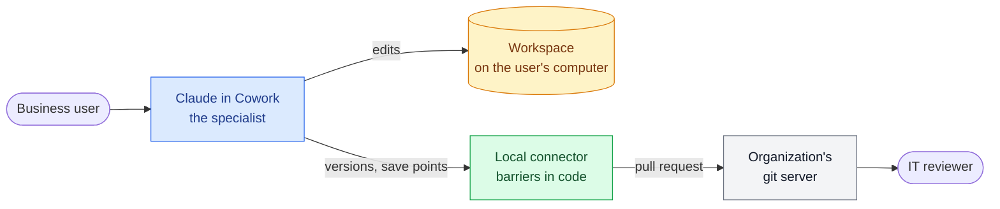

# eunomai-business

> *Good order* for business users who build with AI in Claude Cowork: their work becomes versions, save points
> and pull requests that IT can review, inside barriers that do not depend on the model.

## What it is

eunomai-business acts as the **specialist at the business user's side**: developer, analyst and consultant at
once, managing the work so that an application built by a business user takes the right path from the start.
It advises, asks what is missing, and keeps everything specified, tested and documented, so that whoever reviews
the result receives work that is refined and ready to review, not a first draft.

| Part | What it does | Status |
|---|---|---|
| **Base plugin** (this repository), for every business user | A local connector that signs in through the organization and handles workspaces, versions, save points and pull requests on the organization's git server, without Git installed; and the barriers around it | Built |
| **Configuration by each organization's IT** | Sign-in providers, workspaces folder, diagnostics, set once when building the plugin. Users install and sign in; nothing else | Built |
| **Guided flows** | The specialist's way of working: strict, defined flows that help users say what they want, so the repository ends up with clear specifications, living docs and tested code, and the pull request shows a reviewer what was not specified or not validated | Planned |
| **Project plugins**, one per project | The project's knowledge, its repository and its guard rules, on top of the base plugin | Planned |

It is the counterpart of [eunomai](https://github.com/grojof/eunomai): eunomai is flexible, for developers in
Claude Code; eunomai-business is deliberately strict, for business users in Cowork.

**Status:** in development (0.1.0). The base is built, tested against a fake git server and validated on a real
installation; two checks are partly pending ([validation](docs/validation/hypotheses.md)).

## How it works



The user talks to Claude; Claude edits the workspace and calls the connector; the connector, running outside
Claude's sandbox, signs in as the user and turns the work into a pull request. Details in
[Architecture](docs/architecture.md).

## Quickstart

**IT, to deploy it:** register the sign-in clients, then build and publish the plugin
([Configuration](docs/configuration.md)).

```powershell
copy config.example.json config.local.json   # fill in hosts and client IDs
python tools\build.py                        # -> dist\eunomai-business.zip
```

**Developers, to work on it:**

```powershell
cd connector
uv run --group dev pytest                    # the whole suite against a fake git server
```

## Documentation

| Journey | Pages |
|---|---|
| **Deploy it** (IT) | [Configuration](docs/configuration.md) · [Run the validation](docs/validation/run-the-validation.md) · [Validation checks](docs/validation/hypotheses.md) |
| **Trust it** (IT, security, data protection) | [Barriers](docs/barriers.md) · [Data on computers and servers](docs/data-on-computers.md) |
| **Understand it** (IT, developers) | [Architecture](docs/architecture.md) · [Decisions](docs/decisions.md) · [Guided flows](docs/guided-flows.md) (design) |
| **Run a project repository** (repository owners) | [Good practices for project repositories](docs/project-practices.md) |
| **Build on it** (organizations) | [Extensions](docs/extensions.md) |
| **Follow it** | [Changelog](CHANGELOG.md) |

## Principles

- **Simple for the user:** install the plugin, sign in once in the browser, work. No tokens, no config files,
  no administrator rights.
- **Reusable:** nothing tied to one organization or application; everything that varies is IT's configuration.
- **Its own part only:** the plugin never manages a project's files; projects get
  [good practices](docs/project-practices.md), not impositions.
- **Barriers that hold:** enforced in the connector's code and by the servers, not only by instructions to the
  model.
