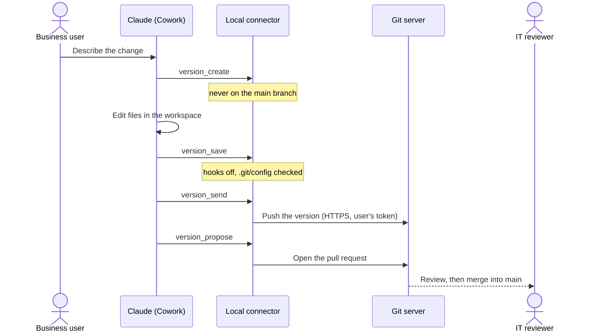
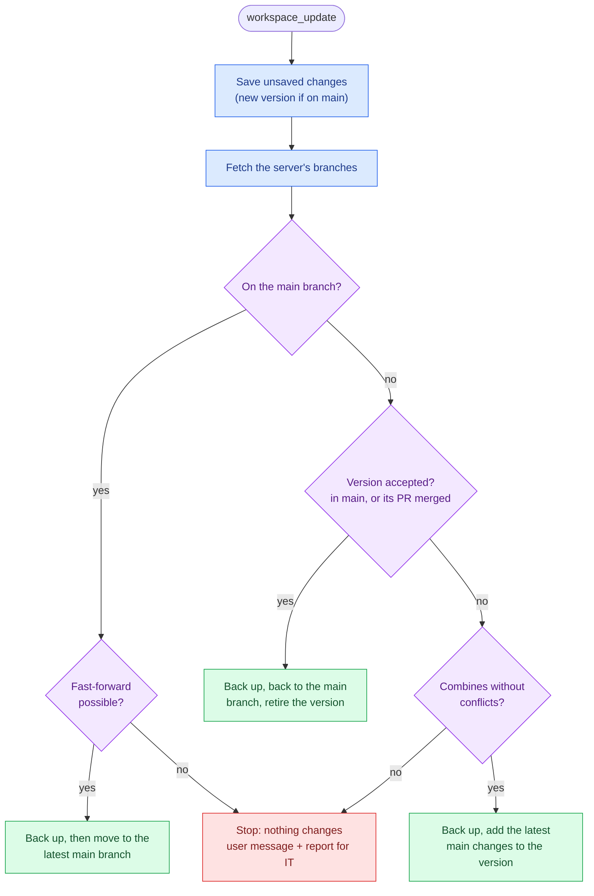
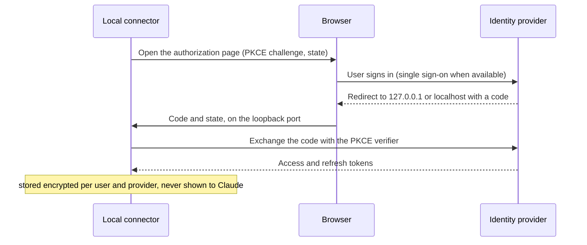

# Architecture

How eunomai-business is split, what is generic and what depends on a particular server. Each part is marked
**built** or **planned**.

## At runtime

Three places are involved. Claude works inside Cowork's sandbox; the local connector runs on the user's
computer, outside it; the organization's servers stay inside the corporate network. The workspace folder is the
only thing the sandbox and the connector share.

## How a version reaches a pull request

The user asks for a change in plain language; Claude edits the files and calls the connector, which does every
git operation and enforces the barriers.

## Bringing the latest changes

`workspace_update` decides on its own, and stops whenever it is not certain. The full rules are in
[barriers.md](barriers.md#bringing-the-latest-changes).

## Sign-in

Once per provider, and again only if the stored record is lost or revoked. Refreshing an expired token needs no
browser.

## Pieces

| Piece | What it is | Status |
|---|---|---|
| Plugin (`plugin/`) | What Claude Desktop installs: the connector's launch settings, plus validation skills and hooks when diagnostics are on. Built per organization from its configuration | Built |
| Local connector (`connector/`) | A Python program started with `uvx` on the user's computer. Claude talks to it through MCP; it runs outside Claude's sandbox ([decision 1](decisions.md#1--a-local-connector-on-the-users-computer)) | Built |
| Build tool | `tools/build.py`: organization configuration + source → `eunomai-business.zip`, after validating the configuration | Built |
| Tests | `connector/tests/`: sign-in, workspaces, versions, barriers, build and tool list against a fake git server (`uv run --group dev pytest` in `connector/`) | Built |

## Connector modules

| Module | Does | Depends on |
|---|---|---|
| `auth` | Sign-in with any OAuth 2.0 provider (authorization code + PKCE, loopback redirect), token refresh | Standard OAuth 2.0; nothing server-specific |
| `store` | Keeps sign-in records encrypted per user | The operating system (DPAPI on Windows, keyring elsewhere) |
| `gitops` | Workspaces, versions, save points, sending, pull requests | Standard git over HTTPS (dulwich), except two Gitea-specific parts below |
| `server` | Exposes the tools to Claude (MCP over stdio): `sign_in_*`, `whoami`, `sign_out`, `workspace_*`, `version_*`; `diag_*` only with diagnostics. Turns every stop into a plain message for the user and a report for IT | MCP |
| `support` | The stop: the user's message, IT's report, the e-mail link | — |
| `hook` | Entry point for the plugin's hooks; today it only logs, with diagnostics on | — |
| `probe` | Diagnostic measurements (`diag_environment`, `diag_reach`) | — |

## Facts the design relies on

- **The workspace is named by its path.** Under the current MCP protocol (`2026-07-28`) the client does not share
  its folders with the connector (roots are deprecated), so the connector cannot discover the folder selected in
  Cowork. It keeps workspaces in its own folder and returns their path; in a local Cowork session on Windows,
  Claude's file tools and the connector see the same path.
- **Per-user data lives in `%LOCALAPPDATA%\eunomai-business`**, not in `CLAUDE_PLUGIN_DATA`, which points inside
  each task's folder and does not outlive the task.

## What is tied to a git hosting

| Part | Today | Generic? |
|---|---|---|
| Clone, send, branches, save points | Standard git over HTTPS | Yes |
| Git sign-in | OAuth 2.0 public client with PKCE; user endpoint and login field configurable | Yes in principle; tested only with Gitea |
| Sending the token | HTTP basic auth (login + OAuth token) | Works with Gitea; to be checked per hosting |
| Pull request, its merged state, and branch link | Gitea API (`/api/v1/repos/.../pulls`) and Gitea web paths | **No**: Gitea only; without it, an accepted version is recognized only by its history (not after a squash merge) |
| Check that the token only goes to the git host | Compares the repository's origin (scheme, host, port) with the `userinfo_url` origin | Works when both share an origin (Gitea); GitHub uses a separate API host |

**Planned:** a hosting adapter per server type (Gitea first, then GitHub and GitHub Enterprise), chosen in the
organization's configuration. Only the hosting-specific rows above move into it.

## Hooks

**Built:** hooks run on the user's computer in Cowork (SessionStart and PreToolUse), through Git Bash if
installed. Today they only log, for measurement, and ship only with diagnostics on.

**Planned: file guard.** A PreToolUse hook that stops Claude from reading or writing sensitive files on the
user's behalf:

- **Base rules shipped with the plugin**, in two kinds:
  - *fixed*: protect eunomai-business itself, such as no writing inside `.git`, which backs the connector's
    sandbox barriers ([barriers.md](barriers.md)); no configuration removes them;
  - *defaults*: common sensitive files (`.env`, keys, certificates, credential files).
- **Organization rules** added in the build configuration: more paths or patterns to deny or to ask about.
  Organizations extend the defaults; they cannot remove the fixed rules.

Before it is built, validation must show (check H9 in
[validation/hypotheses.md](validation/hypotheses.md)):

- the hook receives the tool's input in Cowork (the file path, the shell command);
- a *deny* answer really stops the tool;
- the hook is quick enough to run on every tool call;
- it works without Git on the computer.

**Limits, stated now:** a hook sees a shell command as text. Reading a file by path is easy to catch; a command
built to hide it is not. The guard reduces mistakes and casual exposure; the real boundary for secrets is not
putting them where Claude works. And if the hook cannot start (uv missing, for example), Claude Desktop
treats it as an error and the tool call goes ahead. That limit has to be measured and documented, not assumed.

## Plugin per project

**Planned:** a base plugin (`eunomai-business`) plus one plugin per project for its own skills and knowledge,
sharing the base connector. How one plugin relies on another in Cowork is not yet tested (check H10 in
[validation/hypotheses.md](validation/hypotheses.md)).

A project plugin is also where **project-specific guard rules** would go (for example, "this module is
maintained by another team"), possibly per group of the organization's directory, using the base plugin's
guard. That keeps them out of the project's files and out of the base plugin. Like every hook, these rules
prevent mistakes; they are not permissions (see
[project-practices.md](project-practices.md#who-can-read-and-change-what)).
