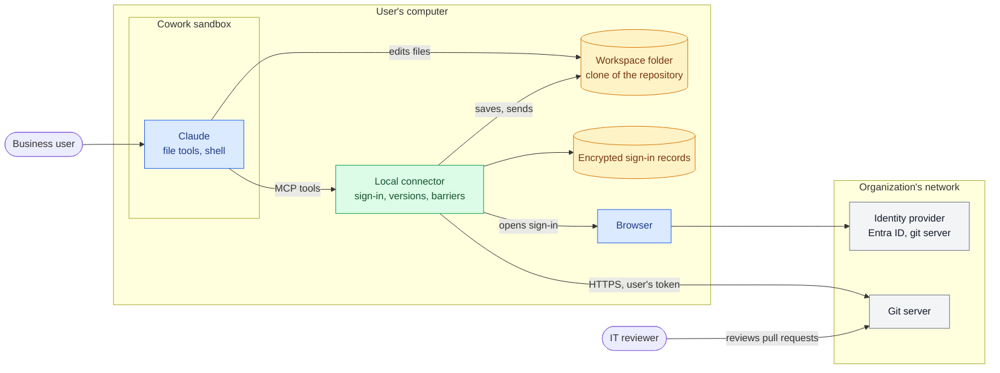
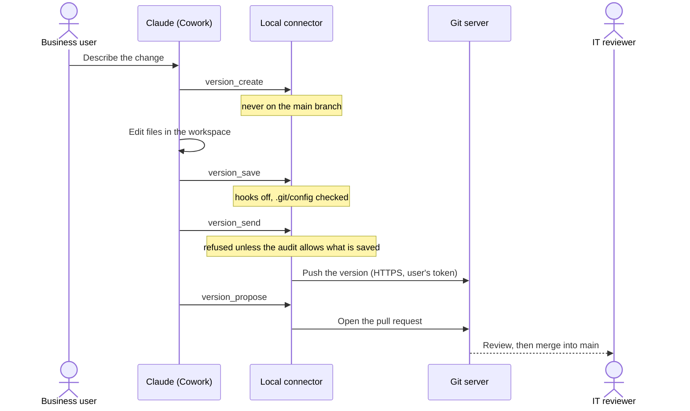
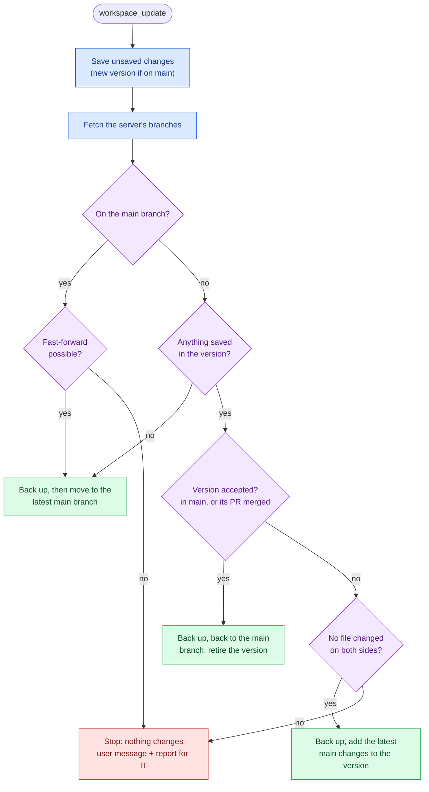
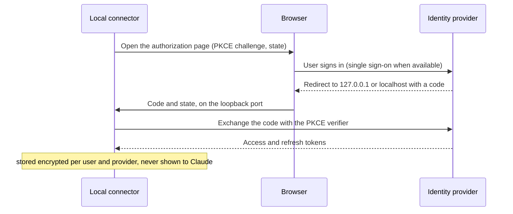

# Architecture

How eunomai-business is split, what is generic and what depends on a particular server. Each part is marked
**built** or **planned**.

## At runtime

Three places are involved. Claude works inside Cowork's sandbox; the local connector runs on the user's
computer, outside it; the organization's servers stay inside the corporate network. The workspace folder is the
only thing the sandbox and the connector share.

## How a version reaches a pull request

The user asks for a change in plain language; Claude edits the files and calls the connector, which does every
git operation and enforces the barriers.

## Bringing the latest changes

`workspace_update` decides on its own, and stops whenever it is not certain. The full rules are in
[barriers.md](barriers.md#bringing-the-latest-changes).

## Sign-in

Once per provider, and again only if the stored record is lost or revoked. Refreshing an expired token needs no
browser.

## Pieces

| Piece | What it is | Status |
|---|---|---|
| Plugin (`plugin/`) | What Claude Desktop installs: the connector's launch settings, the `specialist` and `review-skills` skills and the file guard hook, plus validation skills and measurement hooks when diagnostics are on. Built per organization from its configuration | Built |
| Local connector (`connector/`) | A Python program started with `uv run --frozen` on the user's computer. Claude talks to it through MCP; it runs outside Claude's sandbox ([decision 1](decisions.md#1--a-local-connector-on-the-users-computer)) | Built |
| Build tool | `tools/build.py`: organization configuration + source → `eunomai-business.zip`, after validating the configuration | Built |
| Bill of materials | `tools/sbom.py` → `connector/sbom.cdx.json`, regenerated whenever `connector/uv.lock` changes | Built |
| Maintenance | GitHub workflows: tests on every pull request (Linux, Windows); daily dependency update (`tools/update_dependencies.py`) | Built |
| Tests | `connector/tests/`: sign-in, workspaces, versions, updates, barriers, the file guard, the dependency check and audit, the hooks, the build and the tool list, against a fake git server (`uv run --frozen --group dev pytest` in `connector/`). Those marked `preview` start real processes with uv | Built |

## Connector modules

| Module | Does | Depends on |
|---|---|---|
| `auth` | Sign-in with any OAuth 2.0 provider (authorization code + PKCE, loopback redirect), token refresh | Standard OAuth 2.0; nothing server-specific |
| `store` | Keeps sign-in records encrypted per user | The operating system (DPAPI on Windows, keyring elsewhere) |
| `gitops` | Workspaces, versions, save points, sending, pull requests | Standard git over HTTPS (dulwich), except two Gitea-specific parts below |
| `server` | Exposes the tools to Claude (MCP over stdio): `sign_in_*`, `whoami`, `sign_out`, `workspace_*`, `version_*`, `specialist_settings`, `dependency_check`, `dependency_audit`, `app_preview`, `app_preview_stop`, `project_request`, `project_request_done`, `project_request_withdraw`; `diag_*` only with diagnostics. Turns every stop into a plain message for the user and a report for IT | MCP |
| `preview` | `app_preview`, off by default: the saved version in a temporary folder, audited, run through uv on 127.0.0.1, found again by any connector, with its whole process tree stopped on request and after 60 minutes ([barriers](barriers.md#the-preview-on-the-persons-computer)) | uv; a job object on Windows, a process group elsewhere |
| `watcher` | What owns a preview: a detached process with the standard library alone, which starts its steps, holds its tree, enforces the limit and cleans up | A job object on Windows |
| `support` | The stop: the user's message, IT's report, the e-mail link (RFC 6068, one function for every message to IT) | — |
| `project_request` | A request for a new project: a fixed message for IT in the organization's documentation language, its e-mail link, and a copy kept, pending until the project is cloned or the request is withdrawn ([decision 15](decisions.md#15--a-business-person-never-creates-a-repository)) | — |
| `settings` | The specialist's settings: languages, the organization's context and skills, where code may be written, and what a project declares, the preview included | — |
| `deps` | `dependency_check`: which package version may be used; `dependency_audit`: every package a workspace pins | PyPI, npm and OSV public APIs; the source repositories' web addresses |
| `guard` | The file guard: the PreToolUse hook, and the rules `version_save` enforces | — |
| `hook` | Measurement hook (diagnostics only): logs each tool call and denies two guard-test markers | — |
| `probe` | Diagnostic measurements (`diag_environment`, `diag_reach`) | — |

## Facts the design relies on

- **The workspace is named by its path.** Under the current MCP protocol (`2026-07-28`) the client does not share
  its folders with the connector (roots are deprecated), so the connector cannot discover the folder selected in
  Cowork. It keeps workspaces in its own folder and returns their path; in a local Cowork session on Windows,
  Claude's file tools and the connector see the same path. A task opened without the folder asks Cowork for it and
  carries on (H23).
- **Per-user data lives in `%LOCALAPPDATA%\eunomai-business`**, not in `CLAUDE_PLUGIN_DATA`, which points inside
  each task's folder and does not outlive the task. Claude Desktop installed as a Windows package (MSIX) redirects
  that folder for the processes it starts unless it already exists ([where](data-on-computers.md)).
- **Only tasks on the user's computer.** Cowork tasks may run on Anthropic's servers (Pro and Max always; Team and
  Enterprise as the owner decides). There the sandbox cannot reach private addresses, so internal git servers are
  out of reach, and the two official sources disagree on whether local MCP servers still work through the open
  desktop app ([sources](sources.md#where-cowork-runs-and-local-connectors)). Either way the sandbox would work on
  other files than the ones the connector saves, so the plugin refuses such a task: at the start of the session
  Claude is told, every prompt is blocked with the reason, and every write, shell command and connector call is
  denied. The guard knows it from `CLAUDE_CODE_REMOTE` and `CLAUDE_CODE_REMOTE_SESSION_ID`, which Claude Code sets
  in its cloud sessions for hooks to read, and a tool-call guard that cannot start there blocks anyway
  (`onFailure: "block"`). That Cowork sets them too, and the names of the connector's tools in Cowork, are checked
  by H16.

## What is tied to a git hosting

| Part | Today | Generic? |
|---|---|---|
| Clone, send, branches, save points | Standard git over HTTPS | Yes |
| Git sign-in | OAuth 2.0 public client with PKCE; user endpoint and login field configurable | Yes in principle; tested only with Gitea |
| Sending the token | HTTP basic auth (login + OAuth token) | Works with Gitea; to be checked per hosting |
| Pull request, its merged state, and branch link | Gitea API (`/api/v1/repos/.../pulls`, the 250 most recently updated) and Gitea web paths | **No**: Gitea only; without it, an accepted version is recognized only by its history (not after a squash merge) |
| Check that the token only goes to the git host | Compares the repository's origin (scheme, host, port) with the `userinfo_url` origin | Works when both share an origin (Gitea); GitHub uses a separate API host |

**Planned:** a hosting adapter per server type (Gitea first, then GitHub and GitHub Enterprise), chosen in the
organization's configuration. Only the hosting-specific rows above move into it.

## Hooks

Hooks run on the user's computer, not in Cowork's sandbox: through Git Bash if installed, PowerShell otherwise.

**Built: file guard** (`eunomai-business-guard`, in every build). A PreToolUse hook on the file tools (`Write`,
`Edit`, `MultiEdit`, `NotebookEdit`) and the shell (`Bash`, `mcp__workspace__bash`) that denies, with a reason
Claude can act on:

| Kind | Files | Where | Why |
|---|---|---|---|
| Executables | `.bat`, `.cmd`, `.ps1`, `.vbs`, `.lnk`, `.exe`, `.jar`, `.chm`, `.msi` and other files Windows runs, installs or follows on a double click | Everywhere Claude writes | The files are on the user's computer: a double click would run what the sandbox wrote |
| Project context | `AGENTS.md`, `CLAUDE.md` | In workspaces | IT keeps them; the specialist reads the project's context from the server ([decision 8](decisions.md#8--the-projects-context-belongs-to-it)) |
| Configuration | `.claude/`, `.mcp.json`, `.git/`, the project's declaration (`.eunomai/`), and continuous integration (`.gitea/`, `.github/`, `.forgejo/`, `.gitlab-ci.yml`...) | In workspaces | They configure Claude, the repository, or what runs on IT's servers |

A path is a workspace's when one of its folders has a registered workspace's name. Names Windows treats as the
same file count as protected too: trailing dots and spaces, alternate streams (`run.bat::x`), 8.3 short names.
The guard is set to `onFailure: "block"`: a guard that cannot run stops the write instead of letting it through.

From the shell it also denies git commands that can write in a workspace, and anything that writes or removes inside
its `.git`: the sandbox cannot delete what git leaves there, and the next save stops
([hooks and rules](hooks.md#git-from-the-sandbox-shell)).

`version_save` enforces the same rules on the host, where the sandbox cannot reach: every path must be valid on
Windows and stay inside the workspace; context and configuration files go back to how the last save point has them
(matched regardless of case, never through a link); adding or changing an executable stops the save (removing one
is allowed); and the tree actually committed is checked again, so a file written in the meantime undoes the save
point. A prototype page is saved only with a Content-Security-Policy that loads nothing from other sites. The hook
keeps dangerous files off the computer; the save keeps them out of the repository.

**Built: measurement hooks** (diagnostics only): they log each tool call and deny two guard-test markers (H9).

**Built: organization rules** (`deny` in the build's configuration). After the fixed rules above, the guard
applies IT's rules, written like Claude Code's permission rules: `Bash(<command>)` anywhere, `Edit(<path>)` in
workspaces. They add to the fixed rules and can never remove them ([hooks and rules](hooks.md),
[decision 12](decisions.md#12--organization-rules-in-claude-codes-permission-syntax-applied-by-the-guard)).

**Planned:** default rules for common sensitive files (`.env`, keys, certificates, credential files) in the
example configuration.

**Limits:**

- A hook sees a shell command as text: a plain write to a protected name is caught, a command built to hide it
  is not. The save repeats the check for the repository; nothing repeats it for the disk.
- Script sources that Windows opens with an interpreter (`.js` through Windows Script Host, `.py` through the
  Python launcher) cannot be refused without refusing every web application. Disabling Windows Script Host on
  business users' computers is an operating-system control for IT ([barriers](barriers.md#what-eunomai-business-does-not-protect)).
- The guard reduces mistakes and casual exposure; the real boundary for secrets is not putting them where Claude
  works.

## Plugin per project

eunomai-business holds what is valid for everyone; a project brings its own capabilities (tools over its data,
procedures that use them, hooks for its own folders) as a **project plugin** that depends on eunomai-business, and
its context in `AGENTS.md` ([decision 10](decisions.md#10--a-base-that-holds-for-everyone-projects-bring-their-own-capabilities)).
A project plugin's hook cannot undo eunomai-business's deny; its own hooks act only on its project's workspaces and
its tools carry their own limits. Like every hook, its rules prevent mistakes; the permission is the git server's (see
[project-practices.md](project-practices.md#who-can-read-and-change-what)). In Cowork it loads only while eunomai-business is
on (H10, [research](../research/project-plugin/README.md)). It is made from a
[template](../templates/project-plugin/README.md): a local server with the project's tools, a hook for its deny rules,
and a skill ([decision 11](decisions.md#11--project-plugins-from-a-template-a-project-declares-its-own-development)).
