# Guided flows

**Status:** first version built as the `specialist` skill; its behaviour in Cowork is still to be validated
(checks H11–H15 in [validation](validation/hypotheses.md); first business-user test on 2026-10-24).

The specialist is developer, analyst and consultant at the business user's side. Business users often start
from a vague idea, or from a clear idea that is not the right one; building straight away turns the application
into something nobody can maintain. The specialist analyses first, agrees on something the user can see, and only
then builds, so that the reviewer receives work that is specified, tested and documented.

## How the specialist talks

One question at a time, as a choice with a recommendation; short answers (a sentence, a table, a diagram or a
prototype); assumptions in the open; something to try before anything is built; plain words; and initiative: it
handles versions and proposals on its own. The journey is sized to the request: a wording change skips the
prototype, something new goes through every stage. Nothing is claimed without fresh evidence, and nothing runs on
the user's computer ([decision 7](decisions.md#7--nothing-runs-on-the-users-computer)). The
rules it follows are in the skill itself ([`SKILL.md`](../plugin/skills/specialist/SKILL.md)); when it is not
certain, it stops and hands IT a report ([decision 6](decisions.md#6--the-user-never-resolves-a-technical-problem)).

## The journey

```mermaid
flowchart LR
    idea([Idea]) --> understand["1 Understand<br/>what and why"]
    understand --> shape["2 Shape<br/>clickable prototype"]
    shape --> specify["3 Specify<br/>requirements, scenarios"]
    specify --> build["4 Build<br/>code and tests"]
    build --> deliver["5 Deliver<br/>pull request"]
    deliver --> review([IT review])
    shape -. "change of mind" .-> understand
    specify -. "change of mind" .-> shape
    build -. "something unclear" .-> specify

    classDef action fill:#dbeafe,stroke:#2563eb,color:#1e3a8a
    classDef external fill:#f3f4f6,stroke:#6b7280,color:#111827
    class understand,shape,specify,build,deliver action
    class idea,review external
```

| Stage | The user sees | Behind the scenes | Moves on when |
|---|---|---|---|
| **1 Understand** | A few questions, then "what I understood" in a short table, and a roadmap | Latest changes brought, a version created and named after the goal | The user confirms the summary |
| **2 Shape** | A clickable prototype with sample data, a diagram of the flow | The prototype kept with the change, as the contract for Build | The user approves the prototype |
| **3 Specify** | Requirements and examples of expected behaviour, in plain language | A short OpenSpec change: proposal, specs with scenarios, tasks. Business rules cite their source or are marked open; prototype, proposal, specs and tasks checked against each other | Every requirement has a scenario; open questions are listed |
| **4 Build** | Progress along the roadmap, and screenshots from the sandbox | Tests first from the scenarios, never bent to the code; the whole dependency tree pinned and audited; a save point per task | Every scenario has a passing test, shown by a fresh run |
| **5 Deliver** | "Sent for review" | A readiness check run now (tests, dependency audit, a review of its own changes, docs true to the code), the version sent, the pull request opened with the reviewer's summary | The pull request is open |

After the review, the specialist brings the accepted work back on its own and suggests the next step.

## What the reviewer receives

Every pull request opens with the same short summary: the goal, what was built mapped to the requirements, the
test of each scenario, what is **not settled** (unconfirmed assumptions, rules without a source, open questions),
what was skipped, the skills used besides the specialist and any conflict with its rules, lines proposed for the
project's context, and course changes that matter. Below it, the connector appends its own checks (the dependency
audit), which the model does not write. Gaps are visible instead of hidden, and the reviewer can take any of them
straight back to the user. The template is in
[`deliver.md`](../plugin/skills/specialist/references/deliver.md).

## Keeping it clean

- **Specifications state the current decision,** not its history. A change of course replaces the text; a
  one-line note stays only when the reason matters to the reviewer.
- **Early hypotheses are expected** and marked as such; they are refined as the user's thinking settles.
- **Short by design:** a proposal fits on one screen; a requirement is a sentence plus its scenarios.

## Skills

| Skill | Used when | Does |
|---|---|---|
| `specialist` | Any request to build or change something in a workspace, however vague | Runs the journey, keeps track of the stage, applies the conversation rules |
| One reference per stage | Loaded by `specialist` when a stage starts | The method for that stage, kept out of the conversation until needed |
| `review-skills` | IT reviews a skill or plugin users will have alongside eunomai-business | Security review and conflicts with these rules, with a verdict and exact changes |

The organization's own skills (its brand, its documents) are its own work; the specialist uses those
`organization_skills` names, and only where they agree with its rules. The method borrows, in compact form, from
public practice: evidence before claims and tests that fail first (obra/superpowers), one question at a time and
a consistency pass before building (github/spec-kit), sizing the process to the request (BMAD, GSD), and
Anthropic's review checklist for skills in organizations.

A single entry point means the user never has to know a skill's name. The specialist resumes where the work was
left by reading the open change in the repository, so a new task picks up the same work.

## What the organization decides

Languages, where code may be written and with which technologies, dependency exceptions, and the organization's
context and skills are set by IT when building the plugin ([configuration](configuration.md#the-specialist)); the
project's context is an `AGENTS.md` IT keeps in the repository ([decision 8](decisions.md#8--the-projects-context-belongs-to-it)). Without permission to write
code, the specialist still analyses, shapes and specifies, and delivers that to IT as a proposal.

## To validate

Checks H11 to H15 in [validation](validation/hypotheses.md).
