# Guided flows

**Status:** design, not built.

The specialist is developer, analyst and consultant at the business user's side. Business users often start
from a vague idea, or from a clear idea that is not the right one; building straight away turns the application
into something nobody can maintain. The specialist analyses first, agrees on something the user can see, and only
then builds, so that the reviewer receives work that is specified, tested and documented.

## How the specialist talks

| Rule | In practice |
|---|---|
| **One step at a time** | At most three questions per turn, each with a suggested answer the user can accept |
| **Short** | A sentence, a table, a diagram or a mockup; "more detail?" is offered, never dumped |
| **Assumptions in the open** | What it assumes is listed and confirmed by the user; nothing is built on a silent guess |
| **Visual before building** | A mockup or a diagram to agree on first, with one line on why it saves time |
| **Plain words** | No git, branches or file names; technical detail only when asked |
| **Initiative** | It creates versions, saves, brings the latest changes and proposes, without being asked |
| **Stops go to IT** | When it is not certain, it stops and hands IT a report ([decision 6](decisions.md#6--the-user-never-resolves-a-technical-problem)) |

## The journey

```mermaid
flowchart LR
    idea([Idea]) --> understand["1 Understand<br/>what and why"]
    understand --> shape["2 Shape<br/>mockups, flows"]
    shape --> specify["3 Specify<br/>requirements, scenarios"]
    specify --> build["4 Build<br/>code and tests"]
    build --> deliver["5 Deliver<br/>pull request"]
    deliver --> review([IT review])
    shape -. "change of mind" .-> understand
    specify -. "change of mind" .-> shape
    build -. "something unclear" .-> specify

    classDef action fill:#dbeafe,stroke:#2563eb,color:#1e3a8a
    classDef external fill:#f3f4f6,stroke:#6b7280,color:#111827
    class understand,shape,specify,build,deliver action
    class idea,review external
```

| Stage | The user sees | Behind the scenes | Moves on when |
|---|---|---|---|
| **1 Understand** | A few questions, then "what I understood" in a short table, and a roadmap | Latest changes brought, a version created and named after the goal | The user confirms the summary |
| **2 Shape** | Mockups of the screens, a diagram of the flow, sample data | Mockups kept with the change | The user approves what they see |
| **3 Specify** | Requirements and examples of expected behaviour, in plain language | A short OpenSpec change: proposal, specs with scenarios, tasks. Business rules cite their source or are marked open | Every requirement has a scenario; open questions are listed |
| **4 Build** | Progress along the roadmap and a demo | Code and tests derived from the scenarios; a save point per task | Every scenario has a passing test |
| **5 Deliver** | "Sent for review" | A readiness check, the version sent, the pull request opened with the reviewer's summary | The pull request is open |

After the review, the specialist brings the accepted work back on its own and suggests the next step.

## What the reviewer receives

Every pull request opens with the same short summary, so that gaps are visible instead of hidden:

| Section | Content |
|---|---|
| Goal | What the user wanted, in two lines |
| Built | What changed, mapped to the requirements |
| Evidence | The test for each scenario, and its result |
| Not settled | Assumptions not confirmed, business rules without a source, open questions |
| Skipped | Anything not built or not validated, and why |
| Course changes | Only those that matter to the reviewer, one line each |

The reviewer can take any "Not settled" line straight back to the user.

## Keeping it clean

- **Specifications state the current decision,** not its history. A change of course replaces the text; a
  one-line note stays only when the reason matters to the reviewer.
- **Early hypotheses are expected** and marked as such; they are refined as the user's thinking settles.
- **Short by design:** a proposal fits on one screen; a requirement is a sentence plus its scenarios.

## Skills

| Skill | Used when | Does |
|---|---|---|
| `specialist` | Any request to build or change something in a workspace, however vague | Runs the journey, keeps track of the stage, applies the conversation rules |
| One reference per stage | Loaded by `specialist` when a stage starts | The method for that stage, kept out of the conversation until needed |

A single entry point means the user never has to know a skill's name.

## To check before building

| # | Must hold |
|---|---|
| H11 | The `specialist` skill takes over on vague requests in Cowork and keeps the conversation on the journey |
| H12 | Visuals reach the user in Cowork: tables and Mermaid diagrams render, and a mockup (an HTML page in the workspace) opens |
| H13 | OpenSpec works without its command-line tool on the user's computer: artifacts written in its format, and either the sandbox can run the tool to validate and archive, or the connector does those checks |
| H14 | Code and tests run in Cowork's sandbox for the technologies the organization allows |

## Open questions

- **Which technologies a project may use,** and who sets them (the organization's configuration, or each project
  plugin). Fewer choices make the result more robust and the review easier.
- **The language of specifications:** the user's language, or the organization's.
