# Guided flows

**Status:** first version built as the `specialist` skill; its behaviour in Cowork is still to be validated
(checks H11–H15 in [validation](validation/hypotheses.md); first business-user test on 2026-10-24).

The specialist is developer, analyst and consultant at the business user's side. Business users often start
from a vague idea, or from a clear idea that is not the right one; building straight away turns the application
into something nobody can maintain. The specialist analyses first, agrees on something the user can try, and only
then builds the rest, so that the reviewer receives work that is specified, tested and documented.

## How the specialist talks

One question at a time, as a choice with a recommendation, and a question not answered means waiting: no default
is taken in the user's name for anything that changes the project; short answers (a sentence, a table, a diagram or
a screen to try); everything shown in the user's language and in plain words, status lines between tools included,
with no stage names and no commands; assumptions in the open; something to try early; and initiative: it handles
versions and proposals on its own. The journey is sized to the request: a wording change has nothing to try
first, something new goes through every stage. Nothing is claimed without fresh evidence, and nothing runs on
the user's computer but a preview IT turned on ([decision 7](decisions.md#7--nothing-runs-on-the-users-computer-except-a-preview-it-turns-on)). The
rules it follows are in the skill itself ([`SKILL.md`](../plugin/skills/specialist/SKILL.md)); when it is not
certain, it stops and hands IT a report ([decision 6](decisions.md#6--the-user-never-resolves-a-technical-problem)).

## The journey

```mermaid
flowchart LR
    idea([Idea]) --> understand["1 Understand<br/>what and why"]
    understand --> shape["2 Shape<br/>first real screens"]
    shape --> specify["3 Specify<br/>requirements, scenarios"]
    specify --> build["4 Build<br/>code and tests"]
    build --> deliver["5 Deliver<br/>pull request"]
    deliver --> review([IT review])
    shape -. "change of mind" .-> understand
    specify -. "change of mind" .-> shape
    build -. "something unclear" .-> specify

    classDef action fill:#dbeafe,stroke:#2563eb,color:#1e3a8a
    classDef external fill:#f3f4f6,stroke:#6b7280,color:#111827
    class understand,shape,specify,build,deliver action
    class idea,review external
```

| Stage | The user sees | Behind the scenes | Moves on when |
|---|---|---|---|
| **1 Understand** | A few questions, then "what I understood" in a short table, and a roadmap | Latest changes brought, a version created and named after the goal | The user confirms the summary |
| **2 Shape** | The first real screens with example data, tried on their computer or in the test environment; a diagram of the flow | Unfinished screens on the project's own base, saved, listed in `proposal.md` as the contract for Build | The user approves what they tried |
| **3 Specify** | Requirements and examples of expected behaviour, in plain language | A short OpenSpec change: proposal, specs with scenarios, tasks. Business rules cite their source or are marked open; what was tried, proposal, specs and tasks checked against each other | Every requirement has a scenario; open questions are listed |
| **4 Build** | Progress along the roadmap, and the application as it grows, on their computer, in the test environment or in screenshots from the sandbox | Tests first from the scenarios, never bent to the code; the whole dependency tree pinned and audited; a save point per task | Every scenario has a passing test, shown by a fresh run |
| **5 Deliver** | "Sent for review" | A readiness check run now (tests, dependency audit, a review of its own changes, docs true to the code), the version sent, the pull request opened with the reviewer's summary | The pull request is open |

After the review, the specialist brings the accepted work back on its own and suggests the next step. When IT
asks for changes, `workspace_status` brings the reviewers' requests (decision, notes, line comments not resolved);
the specialist explains them to the user in plain words, asks them about anything that changes what they approved,
reworks in the same version as a small change, and proposes again with a *Review* section: each request and what
was done.

| What the user tries in Shape | When | Why |
|---|---|---|
| The first real screens, through [`app_preview`](barriers.md#the-preview-on-the-persons-computer) or the [test environment](project-practices.md#a-test-environment-without-waiting-for-it) | The project allows code and has one of them | They agree on the real thing, on the project's own base, before tests and the full specification are written. An unfinished screen is not polished, so a change of mind costs little |
| The same screens as screenshots, or nothing until review, said plainly | The project allows code and has neither | The sandbox may not take pictures ([H14](validation/hypotheses.md)) |
| A clickable HTML prototype | The project does not allow code | It is the only thing that can be made, and IT builds from it |

## Before there is a project

A business person never creates a repository ([decision 15](decisions.md#15--a-business-person-never-creates-a-repository)).
When someone wants a new application and no project exists, Understand happens in conversation, with no repository
and no files written; then the request goes to IT, and the journey goes on once IT has created the project.

| Moment | The user sees | Behind the scenes |
|---|---|---|
| Understand | The same questions and "what I understood" | Nothing written anywhere |
| The request | A suggested name (IT decides), and a page in their browser with the request, a button that copies it and one that opens the e-mail to IT; nothing is sent until they send it | `project_request`: a fixed message in the organization's documentation language, with the signed-in git user, on a page that copies it and starts an e-mail to `support_email` with its subject, and a copy in the connector's folder |
| Waiting for IT | At the start of any later task, "has IT created *name*?" | `workspace_list` lists the pending request |
| No longer wanted | When IT refused it or they changed their mind, an offer to withdraw it | `project_request_withdraw`: the request kept, marked withdrawn, and no longer asked about |
| The project exists | The summary they confirmed, and a question only if something changed | The project cloned, the first proposal written from the request and saved, the request marked done with `project_request_done` and kept |

The specialist never offers to create a repository and never asks the person to do anything technical with IT
beyond sending the prepared request. How IT creates it: [project practices](project-practices.md#creating-a-project-from-the-template).

## What the reviewer receives

Every pull request opens with the same short summary: the goal, what was built mapped to the requirements, the
test of each scenario, what is **not settled** (unconfirmed assumptions, rules without a source, open questions),
what was skipped, the skills used besides the specialist and any conflict with its rules, lines proposed for the
project's context, and course changes that matter. Below it, the connector appends its own checks (the dependency
audit), which the model does not write, and a version the audit does not allow is not sent at all
([barriers](barriers.md#dependencies)). Gaps are visible instead of hidden, and the reviewer can take
any of them straight back to the user. The template is in
[`deliver.md`](../plugin/skills/specialist/references/deliver.md).

## Keeping it clean

- **Specifications state the current decision,** not its history. A change of course replaces the text; a
  one-line note stays only when the reason matters to the reviewer.
- **Early hypotheses are expected** and marked as such; they are refined as the user's thinking settles.
- **Short by design:** a proposal fits on one screen; a requirement is a sentence plus its scenarios.

## Skills

| Skill | Used when | Does |
|---|---|---|
| `specialist` | Any request to build or change something in a workspace, however vague, or a new application with no project yet | Runs the journey, keeps track of the stage, applies the conversation rules |
| One reference per stage | Loaded by `specialist` when a stage starts | The method for that stage, kept out of the conversation until needed |
| `review-skills` | IT reviews a skill or plugin users will have alongside eunomai-business | Security review and conflicts with these rules, with a verdict and exact changes |

The organization's own skills (its brand, its documents) are its own work; the specialist uses those
`organization_skills` names, and only where they agree with its rules. The method borrows, in compact form, from
public practice: evidence before claims and tests that fail first (obra/superpowers), one question at a time and
a consistency pass before building (github/spec-kit), sizing the process to the request (BMAD, GSD), and
Anthropic's review checklist for skills in organizations.

A single entry point means the user never has to know a skill's name. The specialist resumes where the work was
left by reading the open change in the repository, so a new task picks up the same work.

## What the organization decides

Languages, dependency exceptions, and the organization's context and skills are set by IT when building the
plugin ([configuration](configuration.md#the-specialist)). Where code may be written, and with which technologies,
each project declares in its repository ([`.eunomai/project.toml`](project-practices.md#where-code-may-be-written)),
and its context is an `AGENTS.md` IT keeps there ([decision 8](decisions.md#8--the-projects-context-belongs-to-it)). Without permission to write
code, the specialist still analyses, shapes with a prototype and specifies, and delivers that to IT as a proposal.

## To validate

Checks H11 to H15 in [validation](validation/hypotheses.md).
