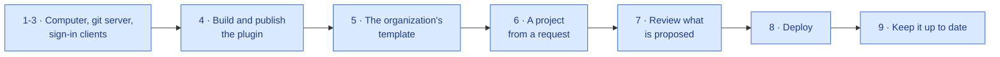

# Setting it up, for IT

The order IT follows, once, and then for each project. Each step says what to do and links to the page that holds the
detail; nothing here repeats a setting's description.

## 1. IT's computer, and people's

| Who | Needs |
|---|---|
| IT | git, [uv](https://docs.astral.sh/uv/) and Python 3.12 through it (`uv python install 3.12`); Edge or Chrome to run a template's browser tests; a clone of this repository and of [eunomai-business-app-base](https://github.com/grojof/eunomai-business-app-base) |
| People who use it | Claude Desktop with Cowork, on a Team or Enterprise plan, with Cowork on the person's computer (not in the cloud); uv, deployed by IT; nothing else: no git, no Python. See [what users need](configuration.md#what-users-need-on-their-computer) and [installing uv in an organization](configuration.md#installing-uv-in-an-organization) |

## 2. The git server

On Gitea (the platform this version supports; GitHub and GitLab are refused until each has its own code):

1. **An organization** for the applications, which owns the template and every project.
2. **People cannot create repositories** in it: IT creates each project from a request (step 6). Members get write
   access to their own project only.
3. **The OAuth application** for the plugin's sign-in: [Gitea (`git`)](configuration.md#gitea-git).
4. **An account for IT's tools**, owner of the organization, and a token for `tools/new_project.py`, kept in a file
   only IT reads (`header_file`). The token creates repositories in the organization from the template, commits a
   file, protects `main`, adds a collaborator and changes a repository's settings: give it write access to
   repositories and to the organization. Check it with `--dry-run` (step 6) before the first real project.
5. **Actions:** with no runner, `actions: false` in `new_project.local.json` turns them off in each project; with
   one, require approval for workflows from people's branches ([checks on the server](project-practices.md#checks-on-the-server)).

## 3. Directory sign-in (optional)

Only if the validation's directory checks are wanted: [Entra ID (`directory`)](configuration.md#entra-id-directory).
The applications themselves never sign people in: their identity proxy does (step 8).

## 4. Build and publish the plugin

1. `config.example.json` to `config.local.json`, filled in: [settings](configuration.md#settings). At least the git
   provider; for applications, `app_preview`, `app_tests`, the organization's context and skills, and
   `dependency_exceptions` with the three packages the base needs (`colorama`, `httpx2-jsfetch`, `execnet`).
2. `python tools/build.py` writes `dist/<plugin_name>.zip`. Several plugins for one organization (applications,
   web): [variants](configuration.md#several-plugins-on-one-computer).
3. Publish the zip to the Claude organization (an Owner, *Organization settings*), or upload it on one computer to
   try it: *Customize → Plugins → Upload plugin*.
4. **A new version:** build again and publish the new zip in its place. On each computer the connector's Python
   environment lives in `%LOCALAPPDATA%\<plugin_name>\environments`, outside the plugin's folder, so Claude
   Desktop can replace or remove the plugin while the connector runs ([data on computers](data-on-computers.md)).
5. **Tell whoever runs the computers' endpoint protection.** The first start of each plugin version writes a new
   Python environment, `python.exe` included, under `%LOCALAPPDATA%\<plugin_name>\environments\` (with Claude
   Desktop installed as a Windows package, under `%LOCALAPPDATA%\Packages\Claude_<id>\LocalCache\Local\`), and runs
   it at once, started by `uv` from a hook or from Claude Desktop. Behaviour-based protection can flag that as
   suspicious. Where it does, an exclusion for that folder and uv's cache, or a rule for uv's own signed executable,
   is that team's decision; the folder holds only the locked packages the audit allows.

## 5. The organization's template

Made, never edited by hand: the base plus the organization's layer (brand, languages, CI).

1. **The layer**, a small repository of its own: `layer.toml` and `files/`
   ([an organization's template](https://github.com/grojof/eunomai-business-app-base/blob/main/docs/base/specification.md#an-organizations-template)).
2. **The template repository**, in the organization, created once with a `main` branch, marked as a template
   (*Settings → Template repository*), with `main` protected.
3. **Make it**, from a clone of the base at the version wanted, into a clone of the template repository:
   `uv run --frozen python tools/make_template.py --layer <layer> --out <template clone> --ref <tag or commit>`.
   It runs the template's own tests and writes `.template-source`.
4. **Audit it** with the organization's exceptions, from this repository:
   `uv run --project connector --frozen python tools/audit.py <template clone>`. A template the audit blocks blocks
   every project made from it.
5. **Publish it** through a pull request in the template repository, reviewed like any change.

## 6. A project from a request

A person's request reaches IT by e-mail, from a page the plugin opens for them.

1. `new_project.example.json` to `new_project.local.json`: the server, the organization, the template, the token's
   file, Actions and `main`'s protection ([creating a project from the template](project-practices.md#creating-a-project-from-the-template)).
2. Save the e-mail as it arrived, then
   `python tools/new_project.py --request <file> --title "<Application name>" --dry-run`, and again without
   `--dry-run`. It creates the repository from the template, commits the application's name, protects `main`, sets
   merged branches to be deleted, gives the requester write access (their git account must exist), turns Actions off
   where there is no runner, checks it all, and prints the reply for the requester.
3. Reply with that text, and the answers to the request's open questions.

## 7. Review what is proposed

The specialist sends a pull request with a fixed summary ([what the reviewer receives](guided-flows.md#what-the-reviewer-receives))
and, below it, the connector's own checks, which the model does not write: the dependency audit, and the last
whole-suite run of the tests on the person's computer for that commit.

| Check | Where |
|---|---|
| The summary's *Not settled* and *Skipped* say nothing IT cannot accept | The summary |
| The tests passed **for this commit** | *Checks by the connector*; the whole output stays on the person's computer, `<data>\tests\` |
| The audit allowed it | *Checks by the connector* |
| Nothing outside the project's place: the base's files, `.eunomai/project.toml`, the CI | The pull request's files |
| Access rules and personal data as agreed | The specs in `openspec/` and their tests |
| The tests run where IT runs them | CI, or the suite on IT's computer: `uv run --frozen python tools/test.py` |

Merge it, or ask for changes in the pull request: the person brings them back to the specialist.

## 8. Deploy

[Deployment](https://github.com/grojof/eunomai-business-app-base/blob/main/docs/base/deployment.md) in the base: the
server's needs, `uv sync` and the migration, the settings, a service unit and the identity proxy in front, with its
headers and roles from groups.

## 9. Keep it up to date

| What | How |
|---|---|
| This repository's and the base's dependencies | A weekly workflow opens a pull request; IT reviews and merges it |
| The organization's template | Step 5 again, from a newer base |
| An application | From the newer template: `tools/update_application.py --template <template repository> --check`, then without `--check`: a branch with the template's change merged and the application's kept, for a pull request ([updating an application](https://github.com/grojof/eunomai-business-app-base/blob/main/docs/base/specification.md#updating-an-application)) |
| The plugin | Step 4 again |

## 10. Uninstalling

[Data on computers and servers](data-on-computers.md#uninstalling): what stays on a computer and how to remove it.
